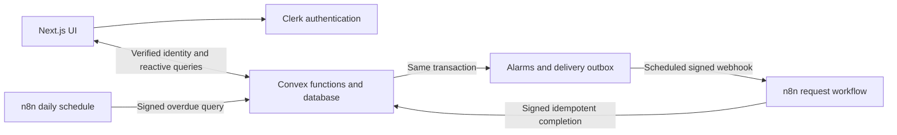

# LendLoop

Borrow what you need. Lend what you don't.

A neighborhood tool-lending board built with Next.js App Router, TypeScript,
Clerk, Convex, and n8n. Database permissions and booking rules live in Convex;
n8n handles signed notification delivery and daily reminders.

## Features

- Public tool catalog with weighted search, category filters, and twelve-item infinite scrolling.
- Clerk sign-in, listing creation/editing in compact dialogs, and complete tool detail pages.
- Date-range borrowing, lender confirmation before accepting/declining, and owner-confirmed returns.
- My listings, My requests, and Incoming requests ordered by requested start date.
- Persistent alarms, exact unread counts, and a toast when a new alarm arrives.
- Admin category management, listing removal, all-loan viewing, and other-user role/trust/status controls.
- Signed n8n request notifications and daily overdue reminders, with durable retry state and visible failures.

## Stack and responsibilities

| Technology | Why it is used |
| --- | --- |
| Next.js App Router / React | File-based routes, shared layouts, interactive forms, and recoverable UI boundaries. |
| TypeScript | Shared contracts across UI, validators, and generated backend APIs. |
| Clerk | Hosted identity, sign-in/account UI, and signed authentication tokens. |
| Convex | Reactive subscriptions, transactional booking rules, persistent data, scheduling, and HTTP integration endpoints. |
| n8n Cloud or Docker | Inspectable webhook and scheduled automation workflows without embedding orchestration in the UI. |
| Tailwind / Lucide / Sonner | Minimal responsive styling, recognizable icons, and concise action feedback. |
| Vitest / convex-test | Isolated backend, authorization, integration-contract, and UI regression tests. |

## Architecture



- `src/app/`: routes, providers, shell, and route/root recovery boundaries.
- `src/components/board/`: filters, sidebar, and paginated tool/request/loan feeds.
- `src/components/tools/`: cards, full detail/edit views, borrow forms, and request decisions.
- `src/components/admin/`: category and user management.
- `src/components/notifications/`: alarm menu, transient toasts, and connection status.
- `src/components/ui/` and `forms/`: reusable dialogs, confirmations, pagination, and form styles.
- `convex/accounts.ts`: identity-derived provisioning and server-side Clerk email sync.
- `convex/catalog.ts`, `tools.ts`, `categories.ts`, `adminUsers.ts`: catalog projections and authorized management.
- `convex/borrowing.ts`: request validation, transactional approval, and owner-only returns.
- `convex/alarms.ts`: persistent alarms, read state, and transactional unread counters.
- `convex/automation.ts`, `http.ts`, `integrationAuth.ts`, `crons.ts`: outbox delivery, HMAC, reminders, and retry recovery.
- `shared/textLimits.ts`: frontend/backend title (80), category (40), and description (500) limits.
- `n8n/`: Cloud-compatible workflow exports, reviewed Code-node snippets, generator, and optional Docker runtime.

## Data model

| Table | Relationships and purpose |
| --- | --- |
| `roles` | Allowed `user` / `admin` roles referenced by users. |
| `users` | Clerk identity, email, role, active/trusted state, and unread alarm count. |
| `categories` | Name, active state, ordering; referenced by tools. |
| `tools` | Owner and category references, condition, description, visibility, removal audit. |
| `borrowRequests` | Tool, borrower, lender snapshot, half-open interval, decision version, retry key. |
| `loans` | One loan per approved request; active/returned lifecycle and reminder summary (legacy states retained for migration). |
| `alarms` | Recipient-specific message, request/loan links, navigation target, and read timestamp. |
| `automationEvents` | Logical event key, delivery attempts, lease/retry timestamps, completion or failure. |
| `auditLogs` | Transactional actor/action/target records for management and lifecycle changes. |

Convex supplies IDs and creation times. Timestamps are Unix milliseconds.
Indexes support owner/recipient lookups, date-sorted requests, booking checks,
search, and due delivery scans. Soft removal preserves existing references.
See [model conventions](convex/MODEL.md) and [seeding](convex/SEEDING.md).

## Authentication and authorization

Clerk proves identity; it does not decide application roles. `ConvexProviderWithClerk`
forwards a token accepted by `convex/auth.config.ts`. Backend functions derive the
caller from `ctx.auth.getUserIdentity()` and look up the local active account.
Roles and trusted-lender state come from Convex, never client arguments or editable
Clerk metadata. Email is fetched from Clerk's server API when needed and stored in
Convex; an existing user's privileges are preserved during synchronization.

| Capability | Public | User | Admin |
| --- | --- | --- | --- |
| Read public cards/categories | Yes | Yes | Yes |
| Create/edit listings | No | Own | Own |
| Remove listings | No | Own | Any |
| Create requests | No | Other owners' available tools | Same rule |
| Accept/decline, confirm return | No | Tool owner only | Only when the owner |
| Read requests/alarms | No | Own participation/recipient only | Same rule |
| Manage categories; view all loans | No | No | Yes |
| Change role/trust/active state | No | No | Other users only |

Inactive accounts fail backend access checks. Admin access does not grant the
right to approve another lender's requests or return another lender's tools.
The client session guard checks Clerk's session deadline and refreshes tokens
on a periodic check, tab focus, visibility changes, and reconnection. An expired
or revoked session, or an explicit Clerk session-expiration/revocation response,
rejection clears Convex authentication, signs out that session, and redirects to
`/signin`. Healthy short-lived JWTs continue refreshing; network/provider outages
are logged without logging out a healthy session. Deadline checks also cover a
stalled token request. Old refresh responses cannot sign out a newly selected session.
An empty refresh result or generic HTTP 401 alone does not establish that a still-active
session has expired; it is logged and retried without signing the user out.

Sidebar links use Next.js client navigation, keeping the header and sidebar mounted
while the route content changes. Each board route supplies its explicit view rather
than re-exporting Dashboard and relying on shared pathname state. A route loading
boundary shows progress without replacing the shared shell. Session monitoring does
not restart on navigation. Admin menu expansion is saved in session storage.

Clock accuracy matters for authentication. A clock behind Clerk can produce
`session-token-nbf` and a handshake redirect even for valid sessions. Synchronize
the system clock rather than relaxing JWT verification.
`node scripts/check-auth.mjs` diagnoses clock drift and checks authenticated HTTP 200
versus anonymous sign-in redirects on local protected routes. It uses development
keys and short-lived tokens for existing active sessions, without printing credentials
or changing application records. It does not authenticate the browser UI itself.

Public projections contain only tool ID, name, and category. Member queries add
condition, description, availability, and viewer-relative ownership flags; no owner
contact details are exposed. Tool detail queries require authentication.

The Next.js proxy explicitly allows only the dashboard, sign-in/up, Next assets,
favicon, and Clerk proxy resources. Anonymous protected page visits redirect to
`/signin`; direct API/write calls return 401. File extensions do not bypass this
check. Convex independently authorizes every private query, mutation, and action,
so calling it directly cannot bypass ownership or roles. Automation HTTP endpoints
use signed service authentication rather than browser sessions.

## Request and loan lifecycle

1. Signed-out Borrow clicks show a sign-in toast. Signed-in neighbors choose
   **From** and **End** dates. The visible End date is inclusive; storage uses
   `[startAt, endAt)` with end at the following UTC midnight. Adjacent bookings
   therefore do not overlap. Dates must start today or later and span at most 90 days.
2. Creation verifies the caller, active listing/category/lender, and ownership.
   A new submission with identical pending dates gets an exact duplicate error;
   overlapping pending dates for the same borrower/tool get an overlap error.
   An already-borrowed tool remains unavailable until its owner records return.
3. A stable client key makes transport retries return the original request.
   The request, lender alarm, and **one** logical outbox event commit together.
   An n8n failure cannot roll back or lose the saved request.
4. The lender confirms Accept or Decline. Acceptance checks bookings and creates
   exactly one **active** loan in the decision transaction. Concurrent approvals
   read the same indexed bookings; Convex conflict handling prevents overlapping
   approved loans. Adjacent future reservations remain valid. There is no Hand Over step.
5. Only the owner sees Mark Returned on active/overdue loans. A confirmation asks
   whether the owner physically received the tool. The backend atomically sets
   `status=returned` and `returnedAt`. Repeated/concurrent returns produce no extra
   alarm, audit, or timestamp change. Borrowers and unrelated admins cannot return
   another owner's loan. Returned and declined cards leave both active request views;
   records remain in Convex and loans remain available to admins for history.
6. **Overdue** is derived from an active loan with `dueAt < now`; it is not a stored
   status. Returned loans no longer block availability or receive future reminders.
   Legacy scheduled rows are converted to active by internal maintenance; reminder
   reads remain backward-compatible. Declined requests create no loan.

Tool creation also uses a stable submission key. A normalized name (Unicode NFKC,
case-insensitive, collapsed whitespace) plus category must be unique among an
owner's nonremoved listings. Other owners may list the same tool; different
categories are allowed. Create and edit enforce this rule transactionally.

Member tool cards and detail pages replace Borrow with a status badge while a tool
has an unexpired pending request or an active/overdue loan. Statuses
derive from indexed Convex records: Pending approval, Borrowed, Overdue,
or Unavailable. There is no Reserved display state: approval immediately means
Borrowed, even if its planned start date is later. Declines/expired requests and confirmed returns release the status
when no other blocking records remain. The public catalog contains only available
tools and still exposes only name/category. Pending requests are not approved
reservations; backend date-overlap checks remain authoritative for concurrent requests.

Expected borrow/listing validation returns `{ok:false, code, message}`, displayed
as a warning and inline feedback. It does not throw a ConvexError or call
console.error. Authentication, ownership violations, and unexpected failures
still throw and retain error logging; no global error suppression is used.

## Alarms and feedback

Alarms are durable and separate from ordinary Sonner success/error messages.
Creation alerts the lender about the incoming loan request, without echoing the
borrower's own submission. Approval/decline results alert the borrower, without
echoing the owner's decision. Returns and overdue reminders target the borrower.
Lender alarms link to Incoming requests; borrower alarms link to My requests.
Visiting these pages marks alarms for the loaded requests as read, scoped to the
current participant. Clicking an alarm also marks it read. Neither operation removes
the alarm from the dropdown. Opening the dropdown clears read counts, not history.
New alarms produce a toast without replaying historical alarms on initial load.
The menu displays the latest five valid alarms, including read entries, while its badge counts **all** unread
alarms. Opening it marks alarms up to that moment as read; later arrivals stay
unread. Read operations and delivery retries cannot decrement/increment twice.
Large read batches continue through internal scheduled functions.

Unread counters are updated in the same transaction as alarm creation/read state.
`alarms:backfillCounts` repairs legacy counters in pages; it is internal/operator-only.
Card titles are plain text, with full titles in tooltips; they do not navigate to
detail pages. Cards clamp long text, while existing detail routes/forms preserve
complete values. Dialogs
support Escape, outside-click dismissal, focus trapping/restoration, and capped width.

## Automation workflows

### Request notifications

Convex schedules one outbox event per request transition, keyed by
`request:<id>:<statusVersion>`. My Requests and Incoming Requests query the same
request with different ownership filters, rather than creating copies. An event
contains a minimal notifications array so recipients can fan out within one run.
Normally one transition invokes n8n once; network retries can invoke it again
with the same key. Database effects remain idempotent, not exactly-once transport. The request
workflow verifies HMAC before parsing/processing the payload, performs logged mock
delivery, and calls the secured completion endpoint. Only event ID, logical key,
kind, title, message, and relative navigation path are sent; Clerk tokens, emails,
and owner contact details are omitted.

### Daily overdue reminders

The second workflow runs at **08:00 UTC daily** (17:00 in Tokyo). It calls
`POST /automation/overdue`, follows signed pagination through active and scheduled
loans, performs mock borrower reminders, and writes results to
`POST /automation/complete`. Pages contain at most 25 loans, including empty pages
with continuation cursors. A key containing loan/borrower/UTC date permits one
logical reminder per day. Completion increments reminder counters once. Returned
or cancelled loans are excluded; obsolete retry deliveries are marked skipped.

Approval also schedules an internal Convex deadline job at dueAt + 1 ms. If the
loan remains unreturned, it atomically persists an overdue alarm, updates the
unread counter, and queues the signed n8n outbox event. A five-minute indexed
recovery cron fills missing initial alerts for legacy loans or interrupted jobs.
Daily n8n reminders use the same loan/UTC-day key, so an initial deadline alert
and a daily workflow cannot create two alarms or delivery counters for one day.
In-app alarm creation does not depend on n8n being published or reachable.

### Security and reliability

- The shared secret is stored in Convex environment variables and an encrypted
  **Crypto v2** n8n credential. Code nodes need no secret/environment access,
  custom variables, or imported crypto modules. Exports contain no secret values.
- Convex signs `<timestamp>.<payload-string>` with HMAC SHA-256. n8n recomputes it
  using the credential, checks freshness, and compares fixed-length signatures
  without an early-exit comparison before mock delivery.
- n8n signs `<timestamp>.POST.<path>.<raw-body>` for each Convex call. Convex verifies
  it with a five-minute freshness window and payload-size limits. Write-backs accept
  event IDs/logical keys only, never arbitrary user/loan patches.
- Event keys are unique logical identities checked transactionally. Delivery is
  **at least once**; alarms, loan creation, and reminder write-backs are idempotent.
  Mock log lines may repeat, but database effects do not.
- HTTP nodes retry three times. Convex uses a 60-second lease, exponential retry
  delays, up to six attempts, and a five-minute recovery sweep for interrupted work.
  Exhausted attempts remain visibly failed and can be requeued by an operator.
- The error workflow retains inspectable failures. Request cards show failed
  automation or recent reminder activity. Structured logs omit raw secrets/emails.
  Error boundaries and a reconnect banner keep the app recoverable.

## Development setup

Requirements: Node.js 22.12+, npm, a Clerk application, and a Convex development
project. n8n Cloud requires no Docker or tunnel.

1. Run `npm ci`, copy `.env.example` to ignored `.env.local`, and replace its
   placeholders using the table below.
2. Enable Clerk's Convex integration (or a JWT template named `convex`, audience
   `convex`). Use the same Clerk instance for frontend keys and backend issuer.
3. Set the backend Clerk environment variables in the Convex dashboard. Local
   `.env.local` alone does not configure the remote backend.
4. Run `npx convex dev` and `npm run dev` in separate terminals.
5. Seed development data with `npx convex run seed:run`. The fictional demo lender
   uses `test@gmail.com` and has no Clerk login. Seeding never grants a real person
   admin access. An authorized operator can use `operators:grantAdmin` to bootstrap.
6. Open http://localhost:3000. In PowerShell use `npx.cmd` / `npm.cmd` if script policy
   blocks the `.ps1` launchers.

## Environment variables

| Variable | Location | Purpose |
| --- | --- | --- |
| `NEXT_PUBLIC_CLERK_PUBLISHABLE_KEY` | `.env.local` / frontend host | Public Clerk instance key. |
| `CLERK_SECRET_KEY` | `.env.local` and Convex env | Server-only Clerk profile/email lookup. |
| `CONVEX_DEPLOYMENT` | `.env.local` | CLI deployment selection, normally `dev:…`. |
| `NEXT_PUBLIC_CONVEX_URL` | `.env.local` / frontend host | Public `.convex.cloud` data endpoint. |
| `CLERK_FRONTEND_API_URL` | Convex env | Clerk token issuer; must match the frontend instance. |
| `AUTOMATION_SHARED_SECRET` | Convex env and n8n Crypto credential | Shared HMAC key; never a public variable. |
| `N8N_WEBHOOK_URL` | Convex env | Published HTTPS production request-webhook URL. |
| `CONVEX_SITE_URL` | Workflow generator input / optional `n8n/.env` | Public `.convex.site` HTTP origin. |
| `N8N_ENCRYPTION_KEY`, `N8N_RUNNERS_AUTH_TOKEN` | Optional Docker `n8n/.env` | Self-hosted credential encryption / runner authentication only. |

Generate private local integration values with `node n8n/setup.mjs`; existing
values are preserved. Never commit `.env.local` or `n8n/.env`. This repo includes
only an empty `n8n/.env.example`. Do not use `$vars` for secrets or paste secrets
into a Code/Crypto node parameter. Production configuration and secret rotation
must be done separately from development.

## Connect your n8n Cloud instance

Use **https://aurox.app.n8n.cloud/**. Follow the full
[Cloud integration guide](n8n/README.md):

1. Generate workflows with `node n8n/build-workflows.mjs` and import errors first,
   then request/overdue JSON exports from `n8n/workflows/`.
2. Create **LendLoop HMAC**, a Crypto credential with the same Hmac Secret as the
   Convex `AUTOMATION_SHARED_SECRET`. Select it in all four Crypto nodes.
3. Select the imported error workflow in both workflow settings, and publish
   the request and overdue workflows. Use the production webhook, not a test URL.
4. Set `N8N_WEBHOOK_URL` on the intended Convex deployment to
   `https://aurox.app.n8n.cloud/webhook/lendloop-requests`.
5. Create/decide a request and inspect alarms, `automationEvents`, and n8n
   Executions. Manually run the daily workflow before relying on its schedule.

No local tunnel is needed: both n8n Cloud and Convex have public HTTPS endpoints.
The optional [Docker alternative](n8n/README.md#docker-alternative) uses the same
credential-based workflows, but cloud Convex needs an HTTPS tunnel to local n8n.
This repository does not grant access to your Cloud account or publish workflows.

## Tests and verification

```sh
npm test
npx tsc --noEmit
npm run lint
node scripts/check-layout.mjs
```

The test suite covers request/role/ownership rules, duplicate and overlapping
ranges, idempotent decisions, owner-only return, unread counters beyond the menu
window, scheduled/active overdue pagination, HMAC tampering/expiry, workflow
preparation/verification contracts, admin controls, and long-text regressions.
Session-monitor tests cover expiry, refreshed tokens, revocation, transient errors,
stalled refreshes, and account switching. Browser checks verify sidebar targets,
route-selected content independent of the shared layout's previous view. A browser
check verifies the actual public sidebar link updates the URL without reloading the
document or remounting the header/sidebar. Private user/admin navigation is covered
by isolated route tests; a live signed-in browser session was not available.
After correcting clock drift, real signed-token HTTP checks returned 200 for
My listings, My requests, Incoming requests, and the checked admin route shells;
anonymous requests still redirected to sign-in. A live authenticated Convex catalog
read also verified pending/available/borrowed/overdue projections and that only
available, nonowned tools offer borrowing. These checks did not create requests,
loans, or notifications, or revoke any existing sessions.
An authenticated live Clerk session was not deliberately revoked during these checks.
The layout script uses headless Chrome/Edge against the running local app; set
`CHROME_PATH` if needed. It checks mobile/desktop layout, compact centered dialogs,
backdrop dismissal, signed-out Borrow feedback, and frontend failure recovery.

Verified: **91 tests passed**, TypeScript, lint, and the production build passed; browser checks
passed at 320/375/768/1440px. Decision/physical-return confirmations and an expected overlap warning were
exercised against isolated mutation stubs, without database writes. The warning
produced neither an uncaught browser exception nor a console.error. Protected
page redirects and anonymous API 401 responses were checked over real HTTP. Mocked integration tests do not
prove that an unpublished workflow or a missing Cloud credential is configured
correctly; complete the manual Cloud checklist too.

The deployed development HTTP endpoint was also checked with empty completion
batches: unsigned **401**, correctly signed **200**, tampered **401**. This checks
the Convex origin/secret pair without changing application data; it does not
claim that n8n Cloud workflows have been imported, published, or executed.

## Decisions, tradeoffs, and limitations

- **Durable alarms before external delivery** keep the lending UX working during
  automation outages. n8n records independent delivery status rather than becoming
  a dependency of the database transaction.
- **Convex as the authority** avoids a second application database or client-side
  role/availability decisions. n8n has narrowly scoped signed endpoints, not a
  database admin key or a Clerk secret.
- **Owner-confirmed return** protects physical-tool availability. Borrower return
  claims or disputes could be a future intermediate state.
- **UTC calendar intervals** make day-boundary/idempotency rules deterministic.
  Timezone-aware pickup times are a future improvement.
- **Mock delivery** satisfies the assignment and sends no real email. Actual email
  or Slack delivery needs an idempotent provider/credential and consented recipients;
  never send to the fictional seed address.
- **Neighborhood-scale indexes and counters** are deliberate. A high-volume service
  should add rate limiting, retention, sharded counters, broader monitoring, and
  migrations tooling. Legacy counter repair scans that user's indexed unread rows.
- Cancellation, disputes, attachments, and self-service account deletion are not
  exposed in this UI. Some schema states reserve room for those extensions.
- Cloud setup/publishing requires account access. Docker startup is not verified
  on a machine without Docker. No claim of a successful live delivery is made until
  a signed end-to-end run is observed in both Convex and n8n.

## Assignment coverage and maintenance

All requested application features have implementations: public name/category
catalog, Clerk sign-in, private listings and request views, category filtering,
backend roles/ownership, approval/decline, active loans and owner returns, both
signed automation workflows, idempotency/retries/error visibility, and recorded
activity on loan cards. Activity reports actual pending/sent/failed/skipped events,
including relative reminder delivery times; it does not invent successful runs.

Operator-only repair utilities (never public application endpoints):

- `maintenance:inspectRequests`: page through request event groups without PII.
- `maintenance:repairRequests`: consolidate legacy groups and activate scheduled
  loans, preserving delivery state and skipping live processing leases.
- `maintenance:normalizeTools`: normalize identities and report existing duplicates
  without deleting tools or loan references.
- `alarms:backfillCounts`: recalculate legacy unread counters if needed.
- `alarms:restoreReadHistory`: restore valid previously dismissed read alarms.
- `overdue:recover`: create missing initial overdue alarms in continued pages.
- `overdue:inspect`: audit persisted initial alarms by loan phase and time, without PII.

Each accepts a pagination cursor; continue until isDone. Inspect results and skipped
groups before considering migration complete. Use the intended development target.

**Not verified externally:** importing/publishing workflows and selecting credentials
in your n8n Cloud account, an actual Cloud end-to-end notification, and a scheduled
Cloud reminder run. Follow [the Cloud setup checklist](n8n/README.md). Mock delivery
is implemented as allowed by the assignment; real email/Slack delivery is optional.
Docker startup is also unverified locally. There is no claim that adding a Cloud
URL automatically configures or publishes that account.

## Code organization and review

Routes/providers belong in `src/app`, feature UI in `src/components`, browser
behavior in `src/hooks` and `src/lib`, cross-layer validation in `shared`, and
database rules/automation in `convex`. n8n snippets and their generated exports
remain together in `n8n`; `scripts` contains development verification tools.

The cleanup removes stale disabled-button behavior, unused card ID/availability
fields and request-to-card ID remapping, and unreachable nullable-user branches
after backend authentication. Tool cards now depend only on display fields.
Import/reference checks found no unreferenced application modules; documented
operator migrations, diagnostic scripts, optional Docker files, and standalone
detail/edit routes are retained because they still serve supported workflows.

Incoming request cards resolve the borrower's display name from Convex only after
checking the current lender's identity. They expose no additional email, Clerk ID,
or arbitrary user lookup; outgoing requests do not include another person's name.
The five-alarm limit is enforced by the indexed backend query; read history and
total unread counters remain independent of that display limit.
